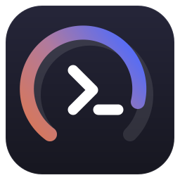
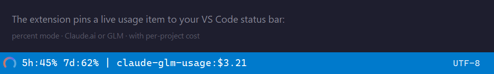

# Claude Code + GLM — 使用量とコスト

> **Claude Code** と **GLM (z.ai)** のトークン使用量・コスト・レート制限クォータを
> VS Code のステータスバーに常時表示。

<div align="center">



[](https://marketplace.visualstudio.com/items?itemName=max-riabov.claude-glm-usage)
[](https://marketplace.visualstudio.com/items?itemName=max-riabov.claude-glm-usage)
[](https://marketplace.visualstudio.com/items?itemName=max-riabov.claude-glm-usage)

🌐 [English](README.md) | [日本語](README.ja.md) | [中文](README.zh.md) | [Русский](README.ru.md)

</div>

> **Claude Code** と **GLM (z.ai)** の両方をファーストクラスのプロバイダーとしてサポートし、
> `~/.claude/settings.json` からどちらを使用中か自動検出します。GLM 使用時は z.ai の実クォータを
> 表示し、各エントリを `message.model` ごとに GLM 料金で正確に計算します。詳細は
> [English README](README.md) を参照してください。

## 概要

**Claude Code + GLM — Usage & Cost** は、エディタを離れることなく [Claude Code](https://claude.ai/code) と GLM (z.ai) の使用状況をリアルタイムで監視できる Visual Studio Code 拡張機能です。

`~/.claude/projects/` からローカルでセッションデータを読み取り、レート制限の使用率ヘッダーを取得するために最大5分に1回だけ Anthropic API に問い合わせます。トークンコストはすべて設定可能なレートを使用してクライアント側で計算されます（デフォルト: Claude Sonnet 4.x 料金）。

> [!NOTE]
> **APIコールは微量かつ Claude Code の使用中のみ発生します。**
> レート制限取得のAPIコールは JSONL が最近更新されたとき（= Claude Code 使用中）にのみ発火します。
> Claude Code を使っていない間はAPIコールは一切行われません。
> 1回あたり約9トークン（`claude-haiku-4-5`）、≈ $0.00013。
> デフォルト設定での月間目安コスト：**$0.01 未満**。
> `claudeStatus.rateLimitApi.enabled: false` で新規APIコールを停止できます。
> キャッシュが存在する場合は最終取得時の利用率 % が `[Xm ago]` 付きで表示され続けます。
> キャッシュがない場合はコスト表示のみにフォールバックします。

> [!WARNING]
> **コスト表示は概算です。** デフォルトのレートは実装時点の Anthropic 公開料金をもとにしており、
> 料金変更を即座に反映しない可能性があります。
> 料金が変更された場合は `claudeStatus.pricing.*` 設定を更新してください
> （この設定は USD 単価を対象とし、z.ai クレジット乗数は内蔵です — 下のクレジット式を参照）。
> 最新の料金は [Anthropic 料金ページ](https://www.anthropic.com/pricing) でご確認ください。

---

## 機能

### 📊 ステータスバー — 常時表示

VS Code ステータスバーにピン留めされたリアルタイム使用状況サマリー。

| 状態 | 表示例 |
|------|--------|
| 通常（%モード、Claude.ai Max） | `🤖 5h:45% 7d:62%` |
| z.ai ピーク時間帯（平日 06:00–10:00 UTC） | `🤖 5h:6% 7d:22% ⚡` |
| 警告 ≥75% | `🤖 5h:78%⚠ 7d:84%⚠` |
| 5 時間の制限に到達 | `🤖 5h:100%✗ 7d:62%` |
| 週間の制限に到達 | `🤖 5h:12% 7d:100%✗` |
| 5時間のみのプラン（7dウィンドウなし） | `🤖 5h:45%` |
| コストモード | `🤖 5h:$14.21 7d:$53.17` |
| コストモード、z.ai（クレジット単位） | `🤖 5h:§2.8k 7d:§9.1k` |
| AWS Bedrock / APIキー（コストのみ） | `🤖 5h:$0.15 7d:$0.42` |
| プロジェクトコスト付き | `🤖 5h:78% 7d:84% \| my-app:$3.21` |
| アクティブセッションのコンテキスト使用率 | `🤖 5h:45% 7d:62% ctx 38%` |
| モデルのコンテキストウィンドウ超過 | `🤖 5h:45% 7d:62% ctx 104%⚠` |
| キャッシュ古い | `🤖 5h:78% 7d:84% [10m ago]` |
| 未ログイン | `🤖 Not logged in` |
| Claude ログイン拒否（401または不明なステータス） | `🤖 Login rejected` |
| Claude アクセス拒否（403） | `🤖 Access refused` |
| Claude ログイン期限切れ、キャッシュなし | `🤖 Login expired` |
| z.ai がAPIキーを拒否 | `🤖 API key rejected` |

ホバーすると、完全なトークン内訳とリセット時間を含む詳細なツールチップが表示されます。

追加セグメント（z.ai アカウントで最も役立ちます）：

- **⚡ ピークインジケーター** — z.ai は自社のピーク時間帯（UTC 平日 06:00–10:00、
  シンガポール時間 SGT では 14:00–18:00）に2倍の課金を適用します。ピーク中は
  クォータウィンドウの横に ⚡ セグメントが表示され、ツールチップに現地時刻の
  「ピークは … まで」が示されます。クレジット式の乗数はピーク時間帯のフルレート
  で、ピーク外のターンは半額で計上されます。z.ai 専用で、他の
  プロバイダーには表示されません。
- **`ctx NN%` コンテキスト使用率** — アクティブセッションのコンテキストウィンドウの
  占有率（モデルのウィンドウまで残り 20k トークンを切ると ⚠）。現在のワークスペースに
  6時間以内のターンを持つセッションがあるときに表示されます。両方の閾値は固定で、
  設定では変更できません。割合はクリップされません：
  「ctx 104%」はトランスクリプトがすでにモデルのウィンドウを超えたことを意味し、
  まもなくコンパクションが行われます。
- **§ クレジットをコスト単位に** — コストセグメントはドル代わりに z.ai クレジットを
  コンパクト表記で表示できます：1000 未満は丸めた整数（`§742`）、1000 からは
  小数1桁＋サフィックス、各ティアで常に小数1桁（`§1.0k`、`§2.8k`、`§1.0M`、
  `§1M` とは書きません）。999.5 以上（1000 に丸まる最初の値）は `§1.0k` の
  ティア表記になります。すべてのコスト表示の単位は
  `claudeStatus.display.primaryUnit` で選択します。デフォルトの `auto` は z.ai では
  クレジット、それ以外のプロバイダーでは USD で、明示的な `credits` も z.ai 以外では
  USD にフォールバックします。

### 🗂 ダッシュボードパネル

ステータスバーアイテムをクリックすると、以下を含むリッチなダッシュボードパネルが開きます：

- **現在の使用量** — 5時間・7日間ウィンドウのカラーコード付きプログレスバー。
  5時間ウィンドウの絶対的なリセット時刻を表示し、z.ai ではピーク中に ⚡ マークが
  付きます。クレジットプランの z.ai では使用済みクレジット・総量・残量に加え、
  「ローカル §X · クォータ §Y（5時間）」の突合行で拡張側の乗数と z.ai 側の課金
  レートの乖離を明示します
- **トークンコスト** — 5時間・今日・7日間・月次推計コスト。▶ トグルで**トークン内訳**を展開すると、
  Input / Output / Cache read / Cache create 別のトークン数・コスト・キャッシュヒット率を表示。
  サブエージェントのトランスクリプト（`<session>/subagents/*.jsonl`）はすべての集計に含まれます
- **プロジェクトコスト** — ワークスペース別内訳（今日・7日間・30日間）
- **予測** — 両単位の消費率（$/時間、z.ai ではクレジット/時間も）、日次・週次予算追跡。
  ライブのクレジットクォータがある z.ai アカウントでは枯渇予測は残クレジットから
  構築されます。**レート制限タイムラインチャート**で
  現在から次回リセットまでの5h利用率予測をグラフ表示
- **料金 & 設定** — 現在のトークン単価・プロバイダー・API状態・キャッシュTTLを常時表示。
  ワンクリックでVS Code設定を開くリンク付き
- **使用履歴** — GitHubスタイルの日次ヒートマップ＋時間帯別パターンバーチャート

パネルはVS Codeのライト・ダーク・ハイコントラストテーマをネイティブにサポートします。

<div align="center">

<br /><br />

</div>

### 🗂 プロジェクトレベルのコスト追跡 *(VS Code専用)*

開いているワークスペースフォルダーをClaude Codeのセッションディレクトリに自動でマッピングし、**その特定のプロジェクトに費やした金額**（今日・今週・今月）を表示します。

マルチルートワークスペースも完全サポート：各フォルダーがダッシュボードに独自の内訳を持ち、ステータスバーには集計が表示されます。

```
🤖 5h:78% 7d:84% | my-app:$3.21          ← 単一ワークスペース
🤖 5h:78% 7d:84% | PJ:$5.43              ← マルチルート集計
```

### 🔮 使用量予測 & 予算アラート

直近30分のアクティビティをもとに、5時間レート制限が枯渇するまでの時間を予測し、事前に警告します。

- **消費率** — 現在の使用量（$/時間、ローリング30分ウィンドウ）
- **枯渇までの時間** — 5時間ウィンドウが満杯になるまでの推定分数（次のウィンドウリセット時刻でキャップ）
- **安全性インジケーター** — 30分以上余裕がある場合は「重いタスクを開始しても安全」と表示
- **日次予算** — 任意のUSD上限を設定可能；設定した閾値（デフォルト80%）に達するとプログレスバーとアラートが表示
- **週次予算** — 任意のUSD週次上限（`claudeStatus.budget.weeklyUsd`）とプログレスバー
- **VS Code通知** — ≤30分でノンブロッキング警告、≤10分で「ダッシュボードを開く」アクション付きエラーダイアログ；予算アラートはウィンドウにつき1回

**設定 → Claude Status** またはコマンドパレットから設定可能：

```
Claude Status: Set Budget...
```

### 📅 使用履歴ヒートマップ

長期的な使用パターンを一目で把握。

- **日次ヒートマップ** — 直近30/60/90日間のGitHub Contributionsスタイルのグリッド；日々の支出を緑の濃淡で表示；セルをホバーすると正確な日付とコストを確認可能
- **時間帯別バーチャート** — 時間帯ごとの平均コスト（直近30日間）；いつClaude Codeを最も多く使用しているかを把握

表示日数は `claudeStatus.heatmap.days`（30/60/90）で設定可能。

---

## 必要条件

- **VS Code** 1.73以降
- **Claude Code CLI** とアクティブなセッション — 拡張機能は
  `~/.claude/projects/**/*.jsonl` からトークンコストデータを読み取ります

**認証はプロバイダーによって任意です：**

| プロバイダー | 認証方法 | 表示内容 |
|-------------|---------|---------|
| Claude.ai サブスクリプション | `claude auth login` — v2.x+ (Mac) はmacOSキーチェーンに保存、旧バージョンは `~/.claude/.credentials.json`。いずれも自動検出 | レート制限 % + コスト |
| AWS Bedrock | AWS認証情報（環境変数または `~/.aws/`） | コストのみ |
| Anthropic APIキー | `ANTHROPIC_API_KEY` 環境変数 | コストのみ |

---

## プラン互換性

> **注意：** この拡張機能は、作者が **Claude.ai Pro プラン**（5時間・7日間の両レート制限ウィンドウを持つ）で開発・テストしています。
>
> AWS Bedrock、直接APIキー、Claude.ai Free、5時間ウィンドウのみのプランなど、その他のプランやプロバイダーは自動検出によるベストエフォートでサポートされています。お使いのプランで予期しない動作が発生した場合は、[Issueを開いて](https://github.com/MaxRyabov/claude-glm-usage/issues)プランの種類をお知らせください。迅速に対応します。

**プランタイプ別の動作：**

| プラン | レート制限表示 | 7dウィンドウ |
|--------|-------------|------------|
| Claude.ai Pro / Max（5h + 7d） | `5h:45% 7d:32%` | ✅ |
| Claude.ai Pro / 5hのみのプラン | `5h:45%` | 自動非表示 |
| AWS Bedrock | コストのみ（`5h:$0.15 7d:$0.42`） | N/A |
| Anthropic APIキー | コストのみ | N/A |

自動検出がうまく機能しない場合は、VS Code設定で `claudeStatus.claudeProvider` を明示的に設定してください。

---

## インストール

### VS Code Marketplace

拡張機能パネルで **「Claude Status」** を検索するか：

```bash
code --install-extension max-riabov.claude-glm-usage
```

### VSIXからインストール

1. [Releases](https://github.com/MaxRyabov/claude-glm-usage/releases) ページから `.vsix` をダウンロード。
2. VS Codeで: **拡張機能 (Ctrl+Shift+X)** → **⋯** → **VSIXからインストール…**

### ソースからビルド

```bash
git clone https://github.com/MaxRyabov/claude-glm-usage.git
cd claude-glm-usage
npm install
npm run package       # → claude-glm-usage-*.vsix
```

---

## 使い方

拡張機能はVS Codeの起動時に自動的に有効化されます（`onStartupFinished`）。

| アクション | 結果 |
|-----------|------|
| ステータスバーを確認 | ライブ使用率・コスト |
| ステータスバーをクリック | ダッシュボードパネルを開く |
| `Ctrl+Shift+Alt+C`（Macでは`⌘⇧⌥C`） | `%` ↔ `$` 表示モードの切り替え |
| **Claude Status: Refresh Now** | APIを強制的に更新 |
| **Claude Status: Open Dashboard** | ダッシュボードパネルを開く |
| **Claude Status: Toggle % / $ Display** | 表示モードの切り替え |
| **Claude Status: Set Budget…** | 日次USD予算を設定または無効化 |

---

## 設定

すべての設定はVS Code設定の `claudeStatus` 名前空間にあります。

| 設定 | 型 | デフォルト | 説明 |
|------|-----|---------|------|
| `claudeStatus.displayMode` | `"percent"` \| `"cost"` | `"percent"` | ステータスバー表示モード |
| `claudeStatus.display.primaryUnit` | `"auto"` \| `"credits"` \| `"usd"` | `"auto"` | すべてのコスト表示の単位：z.ai クレジット（§）または USD（`auto` = z.ai ではクレジット。詳細は上記） |
| `claudeStatus.statusBar.alignment` | `"left"` \| `"right"` | `"left"` | ステータスバーの位置 |
| `claudeStatus.statusBar.showProjectCost` | `boolean` | `true` | ステータスバーにプロジェクトコストを表示 |
| `claudeStatus.cache.ttlSeconds` | `number` (60–3600) | `300` | APIキャッシュTTL（秒） |
| `claudeStatus.rateLimitApi.enabled` | `boolean` | `true` | レート制限%をAnthropicAPIから取得。`false` で新規APIコール停止。キャッシュがあれば `[Xm ago]` 付きで % を継続表示 |
| `claudeStatus.realtime.enabled` | `boolean` | `false` | TTL秒ごとにAPIをポーリング（`rateLimitApi.enabled` が必要） |
| `claudeStatus.budget.dailyUsd` | `number \| null` | `null` | 日次予算（USD）（`null` = 無効） |
| `claudeStatus.budget.weeklyUsd` | `number \| null` | `null` | 週次予算（USD） |
| `claudeStatus.budget.alertThresholdPercent` | `number` (1–100) | `80` | 予算アラート閾値（%） |
| `claudeStatus.notifications.rateLimitWarning` | `boolean` | `true` | レート制限が近い時に警告 |
| `claudeStatus.notifications.rateLimitWarningThresholdMinutes` | `number` (5–120) | `30` | 制限の何分前に警告を表示 |
| `claudeStatus.notifications.budgetWarning` | `boolean` | `true` | 予算閾値超過時に警告 |
| `claudeStatus.heatmap.days` | `30 \| 60 \| 90` | `90` | 使用ヒートマップに表示する日数 |
| `claudeStatus.credentials.path` | `string \| null` | `null` | カスタム認証情報ファイルパス |
| `claudeStatus.claudeProvider` | `"auto"` \| `"claude-ai"` \| `"z-ai"` \| `"custom-endpoint"` \| `"aws-bedrock"` \| `"api-key"` | `"auto"` | プロバイダータイプ（自動検出または明示的指定） |
| `claudeStatus.pricing.inputPerMillion` | `number` | `3.00` | 不明なモデル用のフォールバック入力トークン 1M あたりの USD 単価 |
| `claudeStatus.pricing.outputPerMillion` | `number` | `15.00` | 不明なモデル用のフォールバック出力トークン 1M あたりの USD 単価 |
| `claudeStatus.pricing.cacheReadPerMillion` | `number` | `0.30` | 不明なモデル用のフォールバックキャッシュ読み取りトークン 1M あたりの USD 単価 |
| `claudeStatus.pricing.cacheCreatePerMillion` | `number` | `3.75` | 不明なモデル用のフォールバックキャッシュ作成トークン 1M あたりの USD 単価 |
| `claudeStatus.pricing.models` | `object` | `{}` | モデル名/プレフィックス（例: `"glm-4.6"`、`"claude-opus"`）ごとの価格上書き |

> **z.ai（GLM）**: `~/.claude/settings.json` の `env.ANTHROPIC_BASE_URL` を
> `https://api.z.ai/api/anthropic` に設定すると、プロバイダーを自動検出し、z.ai の
> 5時間／週間クォータ（サブスク画面と同じ利用率%）を表示し、各エントリを `message.model` から
> GLM 料金表（GLM-5.3 / GLM-5.3-Flash は z.ai 公式レートカード）で計算します。
> コストは z.ai レートカードの公式式
> `(入力 × 6.9 + キャッシュ読み取り × 1.7 + 出力 × 24) / 10000` クレジットで
> z.ai クレジット（§）にも集計されます。各項はセッションログの生トークン数で、
> 乗数は 10k トークンあたりのクレジット単価 — 入力 6.9 / キャッシュ読み取り 1.7 /
> 出力 24（flash 以外の全 GLM モデル、4.x と 5.x 共通。このセットは GLM-5.3 の
> レートカードに基づき、z.ai が他の世代を別料金にする場合はダッシュボードの
> 突合行がその乖離を示します）。全 flash 層は入力 2.3 /
> キャッシュ読み取り 0.56 / 出力 8（約3分の1）です。この乗数はピーク時間帯の
> フルレートで、ピーク外のターンはターン自身のタイムスタンプにより半額で
> 計上されます。計算例：ピーク時間帯に 入力 100k + キャッシュ読み取り 200k +
> 出力 50k = (100000×6.9 + 200000×1.7 + 50000×24) / 10000 = §223。キャッシュ
> 作成トークンはクレジット式に含まれません — コーディングプランのレートカードに
> キャッシュ書き込みの独立項はないためです。クレジットは GLM 系モデルに対してエンドポイントに関係なく計上
> され、`claude-*` や不明なモデルは計上されません。クレジット乗数は内蔵で、
> `claudeStatus.pricing.models` は USD 単価にのみ影響します。乗数は GLM-5.3
> 公表レートカードに基づき、変更される可能性があります。トークンが無い場合は
> コストのみ表示にフォールバックします。

```jsonc
// 設定例: settings.json
{
  "claudeStatus.displayMode": "cost",
  // コスト単位: "auto" = z.ai ではクレジット、それ以外は USD（"credits" | "usd"）:
  // "claudeStatus.display.primaryUnit": "auto",
  "claudeStatus.cache.ttlSeconds": 120,
  "claudeStatus.budget.dailyUsd": 5.00,
  "claudeStatus.budget.alertThresholdPercent": 80,
  "claudeStatus.statusBar.showProjectCost": true,
  // AWS Bedrockユーザー — OAuth検出をスキップし、コストのみ表示：
  "claudeStatus.claudeProvider": "aws-bedrock",
  // 新規レート制限APIコールを停止（キャッシュがあれば % を staleness 表示継続）：
  // "claudeStatus.rateLimitApi.enabled": false,
  // Anthropicが料金を変更した場合は以下を更新してください：
  "claudeStatus.pricing.inputPerMillion": 3.00,
  "claudeStatus.pricing.outputPerMillion": 15.00,
  "claudeStatus.pricing.cacheReadPerMillion": 0.30,
  "claudeStatus.pricing.cacheCreatePerMillion": 3.75
}
```

---

## ロードマップ

| 機能 | 状態 |
|------|------|
| データ層（JSONLリーダー、APIクライアント、キャッシュ） | ✅ v0.1.0 |
| %/$表示のステータスバー | ✅ v0.1.0 |
| WebViewダッシュボードスケルトン | ✅ v0.1.0 |
| プロジェクトレベルのコスト追跡 | ✅ v0.1.0 |
| 使用量予測 & 予算アラート | ✅ v0.2.0 |
| セッション履歴ヒートマップ | ✅ v0.3.0 |
| VS Code Marketplace公開 | ✅ v0.3.0 |
| レート制限タイムラインチャート | ✅ v0.4.0 |
| トークン内訳 & キャッシュ効率 | ✅ v0.4.0 |
| 月次コスト推計 | ✅ v0.4.0 |
| 週次予算プログレスバー | ✅ v0.4.0 |
| 料金 & 設定カード（ダッシュボード内） | ✅ v0.4.0 |
| i18n — 英語 / 日本語 / 中国語 | ✅ v0.4.1 |
| macOS キーチェーン認証情報フォールバック（Claude Code v2.x+） | ✅ v0.6.0 |

---

## 関連プロジェクト

- [claude-tmux-status](https://github.com/long-910/claude-tmux-status) — tmuxステータスバー版（同一作者、Python）
- [vscode-view-charset](https://github.com/long-910/vscode-view-charset) — ファイルエンコーディングビューア（同一作者）

---

## コントリビュート

コントリビューションを歓迎します。セットアップ手順・アーキテクチャ・リリース手順については [CONTRIBUTING.md](CONTRIBUTING.md) をご覧ください。

---

## コントリビュータ

このプロジェクトに貢献してくださった方々に感謝します！

[](https://github.com/MaxRyabov/claude-glm-usage/graphs/contributors)

---

## クレジット

本プロジェクトは [long-910/vscode-claude-status](https://github.com/long-910/vscode-claude-status)（MIT）を基に、**Claude Code + GLM (z.ai)** のデュアルサポートを軸にリブランド・再構成したものです。オリジナル作者に深く感謝します。

## ライセンス

[MIT](LICENSE)
