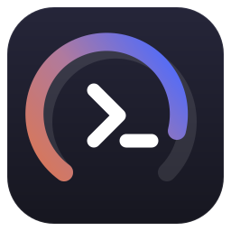
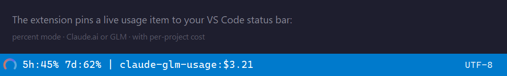

# Claude Code + GLM — Usage & Cost

> Live token usage, cost & rate-limit quota for **Claude Code** and **GLM (z.ai)** —
> always visible in your VS Code status bar.

<div align="center">



[](https://marketplace.visualstudio.com/items?itemName=max-riabov.claude-glm-usage)
[](https://marketplace.visualstudio.com/items?itemName=max-riabov.claude-glm-usage)
[](https://marketplace.visualstudio.com/items?itemName=max-riabov.claude-glm-usage)

🌐 [English](README.md) | [日本語](README.ja.md) | [中文](README.zh.md) | [Русский](README.ru.md)

</div>

## Overview

A Visual Studio Code extension that monitors your coding-agent usage in real time — for
**both Claude Code and GLM (z.ai)** — without leaving your editor.

It reads session data from `~/.claude/projects/` locally (no extra network calls) and shows
live utilization, cost, and rate-limit quota right in the status bar, with a rich dashboard
one click away. Every token is priced **per model** — Claude *and* GLM rates are built in — so
cost is accurate even when you mix providers in the same session.

<div align="center">



<br /><br />


</div>

> [!NOTE]
> **API calls are minimal.** The Claude.ai rate-limit call fires only when a JSONL file was
> recently updated — when you stop using Claude Code, the extension stops calling the API
> entirely. Each call uses ≈ 9 tokens of `claude-haiku-4-5` (≈ $0.00013). Typical cost with
> default settings: **< $0.01 / month**. Set `claudeStatus.rateLimitApi.enabled: false` to stop
> all new API calls. GLM (z.ai) quota is fetched from z.ai's own monitor endpoint using your
> existing `ANTHROPIC_AUTH_TOKEN`.

> [!WARNING]
> **Cost figures are estimates.** Default rates track publicly announced Claude and GLM pricing
> at implementation time and may drift. Update `claudeStatus.pricing.*` /
> `claudeStatus.pricing.models` to match current rates
> ([Anthropic pricing](https://www.anthropic.com/pricing) · [z.ai pricing](https://docs.z.ai/guides/overview/pricing)).

---

## 🔀 Two providers, one meter — Claude Code + GLM

This extension treats **Claude Code** and **GLM (z.ai)** as first-class providers and
auto-detects which one you're using from `~/.claude/settings.json`.

| | Claude.ai (Pro / Max) | GLM / z.ai |
|---|---|---|
| **Rate-limit quota** | 5 h + 7 d utilization % (from Anthropic API) | Real 5 h + weekly quota (from z.ai monitor endpoint) — token and credit plans |
| **Cost** | Per-model Claude pricing | Per-model **GLM** pricing (GLM-4.5/4.6/4.7/5.x, flash tiers free) |
| **Detection** | credentials file / API key | `ANTHROPIC_BASE_URL` host `*.z.ai` |
| **Status bar** | `🤖 5h:45% 7d:62%` | `🤖 5h:6% 7d:22%` (Z.AI / GLM) |

**Mixed usage is priced correctly** — each JSONL entry is priced by its own `message.model`, so
a window that used both Claude and GLM shows an accurate blended cost.

### Point Claude Code at GLM (z.ai)

Add to `~/.claude/settings.json`:

```jsonc
{ "env": {
  "ANTHROPIC_BASE_URL": "https://api.z.ai/api/anthropic",
  "ANTHROPIC_AUTH_TOKEN": "<your z.ai key>"
} }
```

The extension then auto-detects z.ai and:

- **shows your real z.ai quota** — the 5-hour and weekly utilization % from z.ai's subscription
  dashboard (fetched from `…/api/monitor/usage/quota/limit` using your `ANTHROPIC_AUTH_TOKEN`).
  Both kinds of z.ai plan are supported: **token-based** plans report a percentage, while
  **credit-based** plans also show the credits used, the total and what is left, plus your plan
  tier. Falls back to cost-only if no token is found — and if z.ai **rejects** the key, the status
  bar says so instead of showing a misleading 0 %.
- **prices each entry by its GLM model** using a built-in GLM price table (GLM-5.3 and
  GLM-5.3-Flash per the official z.ai rate card) — so cost tracks the real GLM rates
  instead of Claude's ~5–7× higher ones (still an estimate, like every cost figure here).
  Override or add model rates with `claudeStatus.pricing.models`.
- **counts costs in z.ai credits (§) as well** — with the z.ai rate-card formula
  `(input × 6.9 + cache_read × 1.7 + output × 24) / 10000` credits. The terms are raw
  token counts from the session log; the multipliers are z.ai's credit rates per 10k
  tokens — input 6.9 / cache-read 1.7 / output 24, applied to every non-flash GLM model
  (4.x and 5.x alike); every flash tier uses input 2.3 / cache-read 0.56 / output 8
  (~3× cheaper). These are the peak-hour rates — outside the peak window each turn is
  billed at half of them, by the turn's own timestamp. Worked example: 100k input +
  200k cache-read + 50k output in peak ≈ (100000×6.9 + 200000×1.7 + 50000×24) / 10000
  = §223. Cache-creation tokens are not billed separately: z.ai folds cache writes
  into the input term, so the formula has no cache-create term. Credits are earned by
  GLM-family models wherever they run; `claude-*` and unknown models never earn any.
  The credit multipliers are built in — `claudeStatus.pricing.models` overrides USD
  prices only. The § unit itself shows on z.ai accounts — see
  `claudeStatus.display.primaryUnit` below. Multipliers follow the published GLM-5.3
  rate card ([z.ai pricing](https://docs.z.ai/guides/overview/pricing)) and may change.

Other Anthropic-compatible providers (AWS Bedrock, direct API key, custom endpoints) are
supported too — cost-only, priced from local JSONL. See [Provider Compatibility](#provider-compatibility).

---

## Features

### 📊 Status Bar — Always Visible

Real-time usage summary pinned to the VS Code status bar.

| State | Example |
|-------|---------|
| Normal (% mode, Claude.ai Max) | `🤖 5h:45% 7d:62%` |
| GLM / z.ai (real quota) | `🤖 5h:6% 7d:22%` |
| z.ai peak window active (weekdays 06:00–10:00 UTC) | `🤖 5h:6% 7d:22% ⚡` |
| Warning ≥ 75% | `🤖 5h:78%⚠ 7d:84%⚠` |
| 5 h limit reached | `🤖 5h:100%✗ 7d:62%` |
| Weekly limit reached | `🤖 5h:12% 7d:100%✗` |
| 5h-only plan (no 7d window) | `🤖 5h:45%` |
| Cost mode | `🤖 5h:$14.21 7d:$53.17` |
| Cost mode on z.ai (credits unit) | `🤖 5h:§2.8k 7d:§9.1k` |
| AWS Bedrock / API key (cost only) | `🤖 5h:$0.15 7d:$0.42` |
| With project cost | `🤖 5h:78% 7d:84% \| my-app:$3.21` |
| Active session context fill | `🤖 5h:45% 7d:62% ctx 38%` |
| Context over the model window | `🤖 5h:45% 7d:62% ctx 104%⚠` |
| Stale cache | `🤖 5h:78% 7d:84% [10m ago]` |
| Not logged in | `🤖 Not logged in` |
| Claude login rejected (401 or unknown status) | `🤖 Login rejected` |
| Claude access refused (403) | `🤖 Access refused` |
| Claude login expired, nothing cached | `🤖 Login expired` |
| z.ai rejected the API key | `🤖 API key rejected` |

Hover for a detailed tooltip with full token breakdown and reset times.

Additional segments (z.ai accounts get the most out of them):

- **⚡ peak indicator** — z.ai charges double during its peak window (UTC weekdays
  06:00–10:00, i.e. 14:00–18:00 SGT). While it is active a ⚡ segment appears next to the
  quota windows and the tooltip shows the local "peak until …" time; every off-peak turn
  is billed at half the formula's rates in the credit totals. z.ai only — the mark never
  shows for other providers.
- **`ctx NN%` context fill** — how full the active session's context window is, computed
  from that session's last turn (⚠ once fewer than 20k tokens remain to the model's
  window). Shown when the current workspace has a session with a turn newer than 6 hours.
  The share is not clamped: `ctx 104%` means the transcript has already outgrown the
  model's window — expect Claude Code to compact it.
- **§ credits as a cost unit** — cost segments can show z.ai credits instead of dollars
  in compact notation: a rounded integer below 1000 (`§742`), from 1000 one decimal
  with a suffix (`§1.0k`, `§2.8k`, `§1.2M`). The unit is picked by
  `claudeStatus.display.primaryUnit`: `auto` (default) means credits on z.ai and USD
  everywhere else.

### 🗂 Dashboard Panel

Click the status bar item to open a rich dashboard panel with:

- **Current Usage** — colour-coded progress bars for 5 h and 7 d windows; the window that
  reaches its limit turns red. Shows the absolute 5-hour reset time. On z.ai a ⚡ mark
  appears during the peak window. On credit-based z.ai plans each bar also shows the
  credits used, the total and what is left, with your plan tier next to the title. A
  reconciliation line "local §X · by quota §Y over 5h" compares locally counted credits
  with the quota's own `used` — a mismatch means the extension's multipliers have drifted
  from z.ai's rates.
- **Token Cost** — 5 h / today / 7 d / month (est.) costs; expandable **token breakdown**
  shows per-type counts (input / output / cache read / cache create) with individual costs
  and cache hit ratio. Subagent transcripts (`<session>/subagents/*.jsonl`) are counted in
  all aggregates.
- **Project Cost** — per-workspace breakdown (today / 7 days / 30 days)
- **Prediction** — burn rate in both units ($/hr and, on z.ai, credits/hr),
  time-to-exhaustion, daily & weekly budget tracking; on z.ai accounts with a live credit
  quota the exhaustion forecast is built from the remaining credits; **Rate Limit Timeline
  chart** visualises the projected 5 h utilization from now to reset
- **Pricing & Settings** — always-visible card showing current token pricing rates,
  provider, API state, and cache TTL; opens VS Code settings with one click
- **Usage History** — GitHub-style daily heatmap + hourly pattern bar chart

The panel supports light, dark, and high-contrast VS Code themes natively.

### 🗂 Project-Level Cost Tracking

Automatically maps the open workspace folder to its Claude Code session directory and shows how
much you've spent **for that specific project** — today, this week, and this month.

Multi-root workspaces are fully supported: each folder gets its own breakdown in the dashboard,
and the status bar shows the aggregate.

```
🤖 5h:78% 7d:84% | my-app:$3.21          ← single workspace
🤖 5h:78% 7d:84% | PJ:$5.43              ← multi-root aggregate
```

### 🔮 Usage Prediction & Budget Alerts

Based on the last 30 minutes of activity, the extension predicts how long until the 5 h rate
limit is exhausted and warns you before it happens.

- **Burn rate** — current consumption in $/hr (rolling 30-minute window)
- **Time-to-exhaustion** — estimated minutes until the 5 h window is full, capped at the next
  window reset time
- **Daily / weekly budget** — set optional USD caps; progress bars and alerts fire when the
  configured threshold (default 80 %) is reached
- **VS Code notifications** — non-blocking warning as the limit approaches, error dialog when
  it's nearly reached (with "Open Dashboard" action)

Configure via **Settings → Claude Code + GLM Usage** or the command palette
(**Claude+GLM: Set Budget…**).

### 📅 Usage History Heatmap

- **Daily heatmap** — GitHub Contributions-style grid for the last 30 / 60 / 90 days;
  intensity reflects daily spend; hover any cell for exact date and cost
- **Hourly bar chart** — average cost per hour of day (last 30 days)

Number of days is configurable via `claudeStatus.heatmap.days` (30 / 60 / 90).

---

## Requirements

- **VS Code** 1.73 or newer
- **Claude Code CLI** with active sessions — the extension reads
  `~/.claude/projects/**/*.jsonl` for token cost data (this path is shared whether Claude Code
  talks to Claude.ai, z.ai/GLM, Bedrock, or a custom endpoint)

**Authentication is optional** depending on your provider:

| Provider | Authentication | Display |
|----------|---------------|---------|
| Claude.ai subscription | `claude auth login` — credentials stored in macOS Keychain (v2.x+) or `~/.claude/.credentials.json`; detected automatically | Rate-limit % + cost |
| GLM / z.ai | `ANTHROPIC_AUTH_TOKEN` in `~/.claude/settings.json` | Real quota % (+ credits on credit plans) + GLM cost |
| AWS Bedrock | AWS credentials (env vars or `~/.aws/`) | Cost only |
| Anthropic API key | `ANTHROPIC_API_KEY` env var | Cost only |

---

## Provider Compatibility

If auto-detection does not work for your setup, set `claudeStatus.claudeProvider` explicitly in
VS Code Settings.

| Provider | Rate-limit display | 7d window |
|------|--------------------|-----------|
| Claude.ai Pro / Max (5h + 7d) | `5h:45% 7d:32%` | ✅ |
| Claude.ai any 5h-only tier | `5h:45%` | auto-hidden |
| **GLM / z.ai** — token and credit plans | `5h:6% 7d:22%` (real quota) + cost per GLM model | ✅ (weekly) |
| AWS Bedrock | cost only (`5h:$0.15 7d:$0.42`) | N/A |
| Anthropic API key | cost only | N/A |
| Custom Anthropic-compatible endpoint | cost only | N/A |

---

## Installation

### VS Code Marketplace

Search **"Claude Code GLM Usage"** in the Extensions panel, or:

```bash
code --install-extension max-riabov.claude-glm-usage
```

### Install from VSIX

1. Download the `.vsix` from the [Releases](https://github.com/MaxRyabov/claude-glm-usage/releases) page.
2. In VS Code: **Extensions (Ctrl+Shift+X)** → **⋯** → **Install from VSIX…**

### Build from Source

```bash
git clone https://github.com/MaxRyabov/claude-glm-usage.git
cd claude-glm-usage
npm install
npm run package       # → claude-glm-usage-*.vsix
```

---

## Usage

The extension activates automatically on VS Code startup (`onStartupFinished`).

| Action | Result |
|--------|--------|
| Glance at status bar | Live utilization / cost |
| Click status bar | Open dashboard panel |
| `Ctrl+Shift+Alt+C` (`⌘⇧⌥C` on Mac) | Toggle `%` ↔ `$` display mode |
| **Claude+GLM: Refresh Now** | Force API refresh |
| **Claude+GLM: Open Dashboard** | Open dashboard panel |
| **Claude+GLM: Toggle % / $ Display** | Switch display mode |
| **Claude+GLM: Set Budget…** | Set or disable daily USD budget |

---

## Configuration

All settings are under the `claudeStatus` namespace in VS Code Settings.

| Setting | Type | Default | Description |
|---------|------|---------|-------------|
| `claudeStatus.displayMode` | `"percent"` \| `"cost"` | `"percent"` | Status bar display mode |
| `claudeStatus.display.primaryUnit` | `"auto"` \| `"credits"` \| `"usd"` | `"auto"` | Unit of every cost display (cost-mode windows, project-cost segment, cost tooltips): z.ai credits (§) or USD. `auto` = credits on z.ai, USD elsewhere; an explicit `credits` also degrades to USD on non-z.ai providers |
| `claudeStatus.statusBar.alignment` | `"left"` \| `"right"` | `"left"` | Status bar position |
| `claudeStatus.statusBar.showProjectCost` | `boolean` | `true` | Show project cost in status bar |
| `claudeStatus.cache.ttlSeconds` | `number` (60–3600) | `300` | API cache TTL in seconds |
| `claudeStatus.rateLimitApi.enabled` | `boolean` | `true` | Fetch rate-limit % from provider API. When disabled, cached % is still shown with a staleness indicator (`[Xm ago]`) if available |
| `claudeStatus.realtime.enabled` | `boolean` | `false` | Poll rate-limit API every TTL seconds (requires `rateLimitApi.enabled`) |
| `claudeStatus.budget.dailyUsd` | `number \| null` | `null` | Daily budget in USD (`null` = disabled) |
| `claudeStatus.budget.weeklyUsd` | `number \| null` | `null` | Weekly budget in USD |
| `claudeStatus.budget.alertThresholdPercent` | `number` (1–100) | `80` | Budget alert threshold % |
| `claudeStatus.notifications.rateLimitWarning` | `boolean` | `true` | Warn when rate limit is near |
| `claudeStatus.notifications.budgetWarning` | `boolean` | `true` | Warn when budget threshold exceeded |
| `claudeStatus.heatmap.days` | `30 \| 60 \| 90` | `90` | Days shown in usage heatmap |
| `claudeStatus.credentials.path` | `string \| null` | `null` | Custom credentials file path |
| `claudeStatus.claudeProvider` | `"auto"` \| `"claude-ai"` \| `"z-ai"` \| `"custom-endpoint"` \| `"aws-bedrock"` \| `"api-key"` | `"auto"` | Provider type (auto-detect or explicit) |
| `claudeStatus.pricing.inputPerMillion` | `number` | `3.00` | Fallback USD per 1M input tokens (unknown models) |
| `claudeStatus.pricing.outputPerMillion` | `number` | `15.00` | Fallback USD per 1M output tokens (unknown models) |
| `claudeStatus.pricing.cacheReadPerMillion` | `number` | `0.30` | Fallback USD per 1M cache-read tokens (unknown models) |
| `claudeStatus.pricing.cacheCreatePerMillion` | `number` | `3.75` | Fallback USD per 1M cache-creation tokens (unknown models) |
| `claudeStatus.pricing.models` | `object` | `{}` | Per-model price overrides keyed by model name/prefix (e.g. `"glm-4.6"`, `"claude-opus"`) |

```jsonc
// Example: settings.json
{
  "claudeStatus.displayMode": "cost",
  // Cost unit: "auto" = credits on z.ai, USD elsewhere ("credits" | "usd"):
  // "claudeStatus.display.primaryUnit": "auto",
  "claudeStatus.budget.dailyUsd": 5.00,
  "claudeStatus.statusBar.showProjectCost": true,
  // Force GLM/z.ai if auto-detect doesn't pick it up:
  // "claudeStatus.claudeProvider": "z-ai",
  // Add or override a model's rates:
  "claudeStatus.pricing.models": {
    "glm-4.6": { "inputPerMillion": 0.60, "outputPerMillion": 2.20, "cacheReadPerMillion": 0.11, "cacheCreatePerMillion": 0.60 }
  }
}
```

---

## Credits

This project is based on
[long-910/vscode-claude-status](https://github.com/long-910/vscode-claude-status) (MIT) —
huge thanks to the original author. It has been rebranded and repositioned around dual
**Claude Code + GLM (z.ai)** support.

## Contributing

Contributions are welcome. See [CONTRIBUTING.md](CONTRIBUTING.md) for setup instructions,
architecture overview, and release procedures.

## License

[MIT](LICENSE)
