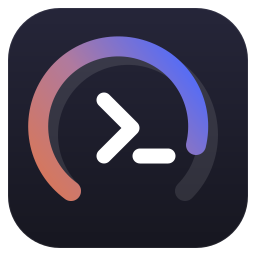
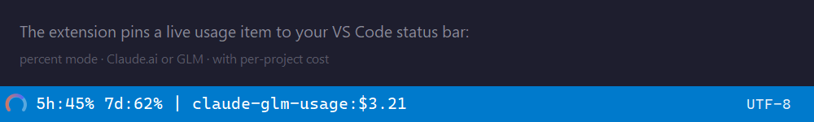

# Claude Code + GLM — использование и стоимость

> Онлайн-статистика использования токенов, стоимости и квоты лимитов для **Claude Code** и
> **GLM (z.ai)** — всегда на виду в строке состояния VS Code.

<div align="center">



[](https://marketplace.visualstudio.com/items?itemName=max-riabov.claude-glm-usage)
[](https://marketplace.visualstudio.com/items?itemName=max-riabov.claude-glm-usage)
[](https://marketplace.visualstudio.com/items?itemName=max-riabov.claude-glm-usage)

🌐 [English](README.md) | [日本語](README.ja.md) | [中文](README.zh.md) | [Русский](README.ru.md)

</div>

## Обзор

Расширение для Visual Studio Code, которое отслеживает использование вашего кодинг-агента в
реальном времени — **как для Claude Code, так и для GLM (z.ai)** — не отвлекая от редактора.

Оно читает данные сессий из `~/.claude/projects/` локально (без дополнительных сетевых запросов) и
показывает текущее использование, стоимость и квоту лимитов прямо в строке состояния, а по одному
клику открывается насыщенная панель. Каждый токен тарифицируется **по модели** — тарифы Claude *и*
GLM встроены, — поэтому стоимость считается по тарифам каждой модели даже при смешении провайдеров в одной сессии.

<div align="center">



<br /><br />


</div>

> [!NOTE]
> **Обращений к API — минимум.** Запрос лимитов Claude.ai выполняется только если JSONL-файл был
> недавно обновлён — когда вы перестаёте пользоваться Claude Code, расширение полностью прекращает
> обращения к API. Каждый вызов расходует ≈ 9 токенов `claude-haiku-4-5` (≈ $0.00013). Типичная
> стоимость с настройками по умолчанию: **< $0.01 / месяц**. Установите
> `claudeStatus.rateLimitApi.enabled: false`, чтобы прекратить все новые обращения к API. Квота GLM
> (z.ai) запрашивается с собственной конечной точки мониторинга z.ai по вашему существующему
> `ANTHROPIC_AUTH_TOKEN`.

> [!WARNING]
> **Значения стоимости — оценочные.** Тарифы по умолчанию отражают публично объявленные цены Claude
> и GLM на момент реализации и могут устареть. Обновите `claudeStatus.pricing.*` /
> `claudeStatus.pricing.models` под актуальные тарифы
> ([цены Anthropic](https://www.anthropic.com/pricing) · [цены z.ai](https://docs.z.ai/guides/overview/pricing)).
> Эти настройки покрывают долларовые цены; кредитные множители z.ai встроены (см. формулу
> кредитов ниже).

---

## 🔀 Два провайдера, один счётчик — Claude Code + GLM

Расширение рассматривает **Claude Code** и **GLM (z.ai)** как полноценные провайдеры и
автоматически определяет, какой из них используется, по `~/.claude/settings.json`.

| | Claude.ai (Pro / Max) | GLM / z.ai |
|---|---|---|
| **Квота лимитов** | Использование за 5ч + 7д, % (через API Anthropic) | Реальная квота за 5ч + неделю (через конечную точку мониторинга z.ai) — токенные и кредитные тарифы |
| **Стоимость** | Тарификация Claude по модели | Тарификация **GLM** по модели (GLM-4.5/4.6/4.7/5.x, flash-уровни бесплатны) |
| **Определение** | файл учётных данных / API-ключ | хост `ANTHROPIC_BASE_URL` `*.z.ai` |
| **Строка состояния** | `🤖 5h:45% 7d:62%` | `🤖 5h:6% 7d:22%` (Z.AI / GLM) |

**Смешанное использование тарифицируется корректно** — каждая запись JSONL оценивается по своему
`message.model`, поэтому окно, в котором использовались и Claude, и GLM, показывает точную
суммарную стоимость.

### Направить Claude Code на GLM (z.ai)

Добавьте в `~/.claude/settings.json`:

```jsonc
{ "env": {
  "ANTHROPIC_BASE_URL": "https://api.z.ai/api/anthropic",
  "ANTHROPIC_AUTH_TOKEN": "<ваш ключ z.ai>"
} }
```

После этого расширение автоматически определяет z.ai и:

- **показывает вашу реальную квоту z.ai** — процент использования за 5 часов и неделю из панели
  подписки z.ai (запрашивается с `…/api/monitor/usage/quota/limit` по вашему
  `ANTHROPIC_AUTH_TOKEN`). Поддерживаются оба вида тарифов z.ai: **токенные** сообщают процент,
  а **кредитные** дополнительно показывают, сколько кредитов израсходовано, сколько всего
  и сколько осталось, а также уровень тарифа. При отсутствии токена расширение переходит в режим
  «только стоимость», а если z.ai **отвергает** ключ, строка состояния прямо сообщает об этом,
  а не показывает обманчивые 0 %.
- **тарифицирует каждую запись по её модели GLM** с помощью встроенной таблицы цен GLM
  (GLM-5.3 и GLM-5.3-Flash — по официальному rate card z.ai) — поэтому стоимость следует
  реальным тарифам GLM, а не завышена в ~5–7 раз по тарифам Claude (как и все числа
  стоимости, это оценка). Переопределяйте или добавляйте тарифы
  моделей через `claudeStatus.pricing.models`.
- **считает стоимость и в кредитах z.ai (§)** — по формуле официального rate card
  `(вход × 6.9 + чтение_кэша × 1.7 + выход × 24) / 10000` кредитов. Слагаемые —
  количества токенов из лога сессии; множители — кредитные ставки z.ai за 10k токенов,
  и это полная (пиковая) ставка: вне пикового окна каждый ход считается по половине
  множителей, по метке времени самого хода.
  - Ставки по тиерам: любая не-flash модель GLM (4.x и 5.x одинаково — набор следует
    rate card GLM-5.3; если z.ai тарифицирует другие поколения иначе, это вскроет
    строка сверки на дашборде) — вход 6.9 / чтение кэша 1.7 / выход 24; все
    flash-уровни — вход 2.3 / чтение кэша 0.56 / выход 8 (примерно втрое дешевле).
  - Числовой пример: 100k входа + 200k чтения кэша + 50k выхода в пик =
    (100000×6.9 + 200000×1.7 + 50000×24) / 10000 = §223.
  - Токены создания кэша в формуле кредитов не учитываются — в rate card тарифа
    нет отдельной ставки записи кэша.
  - Кредиты начисляются моделям семейства GLM независимо от эндпоинта; `claude-*` и
    неизвестные модели кредитов не начисляют. Кредитные множители встроены — настройка
    `claudeStatus.pricing.models` влияет только на долларовые цены. Единица §
    показывается на аккаунтах z.ai — см. `claudeStatus.display.primaryUnit` ниже.
    Множители соответствуют опубликованному rate card GLM-5.3
    ([тарифы z.ai](https://docs.z.ai/guides/overview/pricing)) и могут измениться.

Другие Anthropic-совместимые провайдеры (AWS Bedrock, прямой API-ключ, пользовательские конечные
точки) тоже поддерживаются — в режиме «только стоимость», по локальным JSONL. См.
[Совместимость провайдеров](#совместимость-провайдеров).

---

## Возможности

### 📊 Строка состояния — всегда на виду

Сводка использования в реальном времени, закреплённая в строке состояния VS Code.

| Состояние | Пример |
|-------|---------|
| Обычное (режим %, Claude.ai Max) | `🤖 5h:45% 7d:62%` |
| GLM / z.ai (реальная квота) | `🤖 5h:6% 7d:22%` |
| Активно пиковое окно z.ai (будние дни по UTC, 06:00–10:00) | `🤖 5h:6% 7d:22% ⚡` |
| Предупреждение ≥ 75% | `🤖 5h:78%⚠ 7d:84%⚠` |
| Исчерпан лимит 5ч | `🤖 5h:100%✗ 7d:62%` |
| Исчерпан недельный лимит | `🤖 5h:12% 7d:100%✗` |
| План только 5ч (без окна 7д) | `🤖 5h:45%` |
| Режим стоимости | `🤖 5h:$14.21 7d:$53.17` |
| Режим стоимости на z.ai (в кредитах) | `🤖 5h:§2.8k 7d:§9.1k` |
| AWS Bedrock / API-ключ (только стоимость) | `🤖 5h:$0.15 7d:$0.42` |
| Со стоимостью проекта | `🤖 5h:78% 7d:84% \| my-app:$3.21` |
| Заполнение контекста активной сессии | `🤖 5h:45% 7d:62% ctx 38%` |
| Контекст сверх окна модели | `🤖 5h:45% 7d:62% ctx 104%⚠` |
| Устаревший кэш | `🤖 5h:78% 7d:84% [10m ago]` |
| Вход не выполнен | `🤖 Not logged in` |
| Anthropic отверг вход (401 или неизвестный статус) | `🤖 Login rejected` |
| Anthropic отказал в доступе (403) | `🤖 Access refused` |
| Срок входа Claude истёк, в кэше пусто | `🤖 Login expired` |
| z.ai отверг ключ API | `🤖 API key rejected` |

Наведите курсор для подробной подсказки с полной разбивкой токенов и временем сброса.

Дополнительные сегменты (наиболее полезны на аккаунтах z.ai):

- **⚡ индикатор пика** — z.ai тарифицирует по двойной ставке в своё пиковое окно
  (будние дни по UTC 06:00–10:00, т.е. 14:00–18:00 SGT). Пока окно активно, рядом с окнами квоты появляется
  сегмент ⚡, а в подсказке — локальное время «пик до …»; множители формулы кредитов —
  пиковая ставка, вне окна каждый ход считается по половине. Только z.ai — для других
  провайдеров метка не показывается никогда.
- **`ctx NN%` заполнение контекста** — насколько заполнено окно контекста активной сессии,
  по её последнему ходу (⚠ когда до окна модели остаётся меньше 20k токенов). Показывается,
  когда в текущей рабочей области есть сессия с ходом новее 6 часов; оба порога
  фиксированы и настройками не меняются. Доля не обрезается:
  «ctx 104%» значит, что транскрипт уже превысил окно модели — ждите компакции от
  Claude Code.
- **§ кредиты как единица стоимости** — стоимостные сегменты могут показывать кредиты z.ai
  вместо долларов в компактной записи: до 1000 — округлённое целое (`§742`), от 1000 —
  один знак после запятой с суффиксом, в каждом тиере ровно один знак (`§1.0k`, `§2.8k`,
  `§1.0M`, но не `§1M`); значения от 999.5 — первое, что скругляется до 1000, —
  показываются формой тиера (`§1.0k`). Единицу всех стоимостных показов выбирает
  `claudeStatus.display.primaryUnit`: `auto` (по умолчанию) означает кредиты на z.ai и
  доллары у остальных провайдеров; явные `credits` у не-z.ai провайдеров тоже дают
  доллары.

### 🗂 Панель

Нажмите на элемент строки состояния, чтобы открыть насыщенную панель:

- **Текущее использование** — цветные индикаторы прогресса для окон 5ч и 7д; окно, достигшее
  лимита, становится красным. Показывается абсолютное время сброса 5-часового окна; на z.ai
  в пиковое окно появляется метка ⚡. На кредитных тарифах z.ai под каждым индикатором показано,
  сколько кредитов израсходовано, сколько всего и сколько осталось, а рядом с заголовком —
  уровень тарифа. Строка сверки «локально §X · по квоте §Y за 5ч» сопоставляет локально
  посчитанные кредиты с собственным `used` квоты: расхождение означает дрейф тарифов
  расширения относительно z.ai.
- **Стоимость токенов** — стоимость за 5ч / сегодня / 7д / месяц (оценка); разворачиваемая
  **разбивка токенов** показывает количество по типам (ввод / вывод / чтение из кэша / создание
  кэша) с отдельной стоимостью и долей попаданий в кэш. Логи субагентов
  (`<session>/subagents/*.jsonl`) учитываются во всех агрегатах
- **Стоимость проекта** — разбивка по рабочим областям (сегодня / 7 дней / 30 дней)
- **Прогноз** — скорость расхода в обеих единицах ($/ч и, на z.ai, кредиты/ч), время до
  исчерпания, отслеживание дневного и недельного бюджета; на аккаунтах z.ai с живой кредитной
  квотой прогноз исчерпания строится от оставшихся кредитов; **график таймлайна лимита**
  визуализирует прогноз использования за 5 часов от текущего момента до сброса
- **Тарифы и настройки** — всегда видимая карточка с текущими тарифами токенов, провайдером,
  состоянием API и временем жизни кэша; открывает настройки VS Code одним кликом
- **История использования** — ежедневная тепловая карта в стиле GitHub + столбчатая диаграмма
  почасового профиля

Панель нативно поддерживает светлую, тёмную и высококонтрастную темы VS Code.

### 🗂 Учёт стоимости по проектам

Автоматически сопоставляет открытую папку рабочей области с её каталогом сессий Claude Code и
показывает, сколько вы потратили **на конкретный проект** — сегодня, за неделю и за месяц.

Многокорневые рабочие области полностью поддерживаются: у каждой папки своя разбивка в панели, а в
строке состояния показывается суммарное значение.

```
🤖 5h:78% 7d:84% | my-app:$3.21          ← одна рабочая область
🤖 5h:78% 7d:84% | PJ:$5.43              ← суммарно по многокорневой
```

### 🔮 Прогноз использования и оповещения о бюджете

На основе последних 30 минут активности расширение прогнозирует, через сколько будет исчерпан
5-часовой лимит, и предупреждает заранее.

- **Скорость расхода** — текущее потребление в $/ч (скользящее окно 30 минут)
- **Время до исчерпания** — оценка минут до заполнения окна 5ч, ограниченная временем ближайшего
  сброса окна
- **Дневной / недельный бюджет** — задайте необязательные лимиты в USD; индикаторы прогресса и
  оповещения срабатывают при достижении заданного порога (по умолчанию 80 %)
- **Уведомления VS Code** — ненавязчивое предупреждение при приближении к лимиту, диалог с ошибкой
  при его почти полном достижении (с действием «Открыть панель»)

Настраивается через **Параметры → Claude Code + GLM Usage** или палитру команд
(**Claude+GLM: Задать бюджет…**).

### 📅 Тепловая карта истории использования

- **Ежедневная тепловая карта** — сетка в стиле «вкладов» GitHub за последние 30 / 60 / 90 дней;
  интенсивность отражает дневной расход; наведите курсор на любую ячейку для точной даты и стоимости
- **Почасовая диаграмма** — средняя стоимость по часам суток (за последние 30 дней)

Количество дней настраивается через `claudeStatus.heatmap.days` (30 / 60 / 90).

---

## Требования

- **VS Code** 1.73 или новее
- **Claude Code CLI** с активными сессиями — расширение читает `~/.claude/projects/**/*.jsonl` для
  данных о стоимости токенов (этот путь общий независимо от того, работает ли Claude Code с
  Claude.ai, z.ai/GLM, Bedrock или пользовательской конечной точкой)

**Аутентификация необязательна** и зависит от провайдера:

| Провайдер | Аутентификация | Отображение |
|----------|---------------|---------|
| Подписка Claude.ai | `claude auth login` — учётные данные хранятся в macOS Keychain (v2.x+) или `~/.claude/.credentials.json`; определяется автоматически | Лимиты % + стоимость |
| GLM / z.ai | `ANTHROPIC_AUTH_TOKEN` в `~/.claude/settings.json` | Реальная квота % (+ кредиты на кредитных тарифах) + стоимость GLM |
| AWS Bedrock | Учётные данные AWS (переменные окружения или `~/.aws/`) | Только стоимость |
| API-ключ Anthropic | Переменная окружения `ANTHROPIC_API_KEY` | Только стоимость |

---

## Совместимость провайдеров

Если автоопределение не сработало для вашей конфигурации, задайте `claudeStatus.claudeProvider`
явно в настройках VS Code.

| Провайдер | Отображение лимитов | Окно 7д |
|------|--------------------|-----------|
| Claude.ai Pro / Max (5ч + 7д) | `5h:45% 7d:32%` | ✅ |
| Claude.ai любой уровень только с 5ч | `5h:45%` | скрывается автоматически |
| **GLM / z.ai** — токенные и кредитные тарифы | `5h:6% 7d:22%` (реальная квота) + стоимость по модели GLM | ✅ (неделя) |
| AWS Bedrock | только стоимость (`5h:$0.15 7d:$0.42`) | Н/Д |
| API-ключ Anthropic | только стоимость | Н/Д |
| Пользовательская Anthropic-совместимая конечная точка | только стоимость | Н/Д |

---

## Установка

### VS Code Marketplace

Найдите **«Claude Code GLM Usage»** в панели расширений или:

```bash
code --install-extension max-riabov.claude-glm-usage
```

### Установка из VSIX

1. Скачайте `.vsix` со страницы [Releases](https://github.com/MaxRyabov/claude-glm-usage/releases).
2. В VS Code: **Расширения (Ctrl+Shift+X)** → **⋯** → **Установить из VSIX…**

### Сборка из исходников

```bash
git clone https://github.com/MaxRyabov/claude-glm-usage.git
cd claude-glm-usage
npm install
npm run package       # → claude-glm-usage-*.vsix
```

---

## Использование

Расширение активируется автоматически при запуске VS Code (`onStartupFinished`).

| Действие | Результат |
|--------|--------|
| Взгляд на строку состояния | Текущее использование / стоимость |
| Клик по строке состояния | Открыть панель |
| `Ctrl+Shift+Alt+C` (`⌘⇧⌥C` на Mac) | Переключить отображение `%` ↔ `$` |
| **Claude+GLM: Обновить сейчас** | Принудительно обновить через API |
| **Claude+GLM: Открыть панель** | Открыть панель |
| **Claude+GLM: Переключить отображение % / $** | Сменить режим отображения |
| **Claude+GLM: Задать бюджет…** | Задать или отключить дневной бюджет в USD |

---

## Конфигурация

Все настройки находятся в пространстве имён `claudeStatus` в настройках VS Code.

| Настройка | Тип | По умолчанию | Описание |
|---------|------|---------|-------------|
| `claudeStatus.displayMode` | `"percent"` \| `"cost"` | `"percent"` | Режим отображения в строке состояния |
| `claudeStatus.display.primaryUnit` | `"auto"` \| `"credits"` \| `"usd"` | `"auto"` | Единица всех стоимостных показов: кредиты z.ai (§) или USD (`auto` = кредиты на z.ai; подробности выше) |
| `claudeStatus.statusBar.alignment` | `"left"` \| `"right"` | `"left"` | Положение в строке состояния |
| `claudeStatus.statusBar.showProjectCost` | `boolean` | `true` | Показывать стоимость проекта в строке состояния |
| `claudeStatus.cache.ttlSeconds` | `number` (60–3600) | `300` | Время жизни кэша API в секундах |
| `claudeStatus.rateLimitApi.enabled` | `boolean` | `true` | Получать % лимитов через API провайдера. Если выключено, кэшированный % всё равно показывается с индикатором устаревания (`[Xm ago]`) при наличии |
| `claudeStatus.realtime.enabled` | `boolean` | `false` | Опрашивать API лимитов каждые TTL секунд (требует `rateLimitApi.enabled`) |
| `claudeStatus.budget.dailyUsd` | `number \| null` | `null` | Дневной бюджет в USD (`null` = отключено) |
| `claudeStatus.budget.weeklyUsd` | `number \| null` | `null` | Недельный бюджет в USD |
| `claudeStatus.budget.alertThresholdPercent` | `number` (1–100) | `80` | Порог оповещения о бюджете, % |
| `claudeStatus.notifications.rateLimitWarning` | `boolean` | `true` | Предупреждать при приближении к лимиту |
| `claudeStatus.notifications.budgetWarning` | `boolean` | `true` | Предупреждать при превышении порога бюджета |
| `claudeStatus.heatmap.days` | `30 \| 60 \| 90` | `90` | Дней на тепловой карте использования |
| `claudeStatus.credentials.path` | `string \| null` | `null` | Пользовательский путь к файлу учётных данных |
| `claudeStatus.claudeProvider` | `"auto"` \| `"claude-ai"` \| `"z-ai"` \| `"custom-endpoint"` \| `"aws-bedrock"` \| `"api-key"` | `"auto"` | Тип провайдера (автоопределение или явно) |
| `claudeStatus.pricing.inputPerMillion` | `number` | `3.00` | Резервная стоимость USD за 1M входных токенов (неизвестные модели) |
| `claudeStatus.pricing.outputPerMillion` | `number` | `15.00` | Резервная стоимость USD за 1M выходных токенов (неизвестные модели) |
| `claudeStatus.pricing.cacheReadPerMillion` | `number` | `0.30` | Резервная стоимость USD за 1M токенов чтения из кэша (неизвестные модели) |
| `claudeStatus.pricing.cacheCreatePerMillion` | `number` | `3.75` | Резервная стоимость USD за 1M токенов создания кэша (неизвестные модели) |
| `claudeStatus.pricing.models` | `object` | `{}` | Переопределения цен по моделям с ключом в виде имени/префикса модели (например, `"glm-4.6"`, `"claude-opus"`) |

```jsonc
// Пример: settings.json
{
  "claudeStatus.displayMode": "cost",
  // Единица стоимости: "auto" = кредиты на z.ai, USD у остальных ("credits" | "usd"):
  // "claudeStatus.display.primaryUnit": "auto",
  "claudeStatus.budget.dailyUsd": 5.00,
  "claudeStatus.statusBar.showProjectCost": true,
  // Принудительно выбрать GLM/z.ai, если автоопределение не сработало:
  // "claudeStatus.claudeProvider": "z-ai",
  // Добавить или переопределить тарифы модели:
  "claudeStatus.pricing.models": {
    "glm-4.6": { "inputPerMillion": 0.60, "outputPerMillion": 2.20, "cacheReadPerMillion": 0.11, "cacheCreatePerMillion": 0.60 }
  }
}
```

---

## Благодарности

Проект основан на
[long-910/vscode-claude-status](https://github.com/long-910/vscode-claude-status) (MIT) — огромная
благодарность автору оригинала. Он был переименован и переориентирован на двойную поддержку
**Claude Code + GLM (z.ai)**.

## Участие в разработке

Мы рады вкладу. Инструкции по настройке, обзор архитектуры и порядок выпуска релизов см. в
[CONTRIBUTING.md](CONTRIBUTING.md).

## Лицензия

[MIT](LICENSE)
